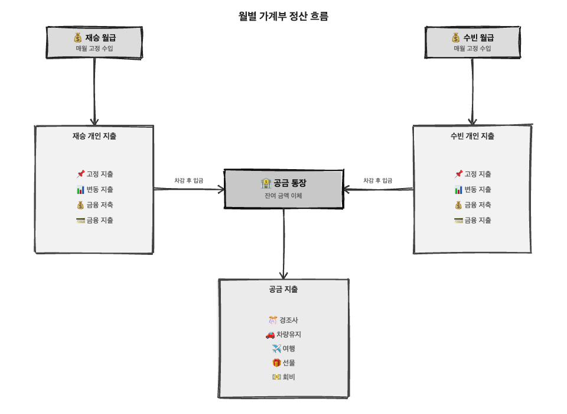
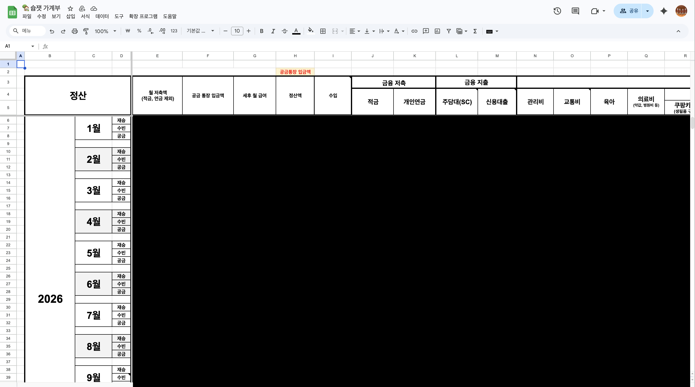
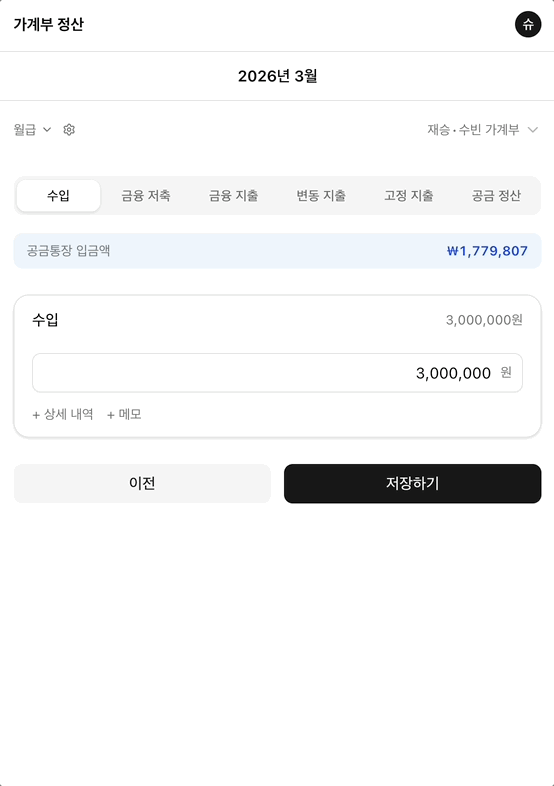
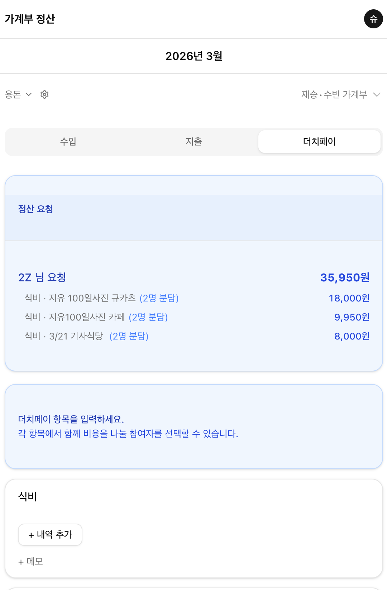
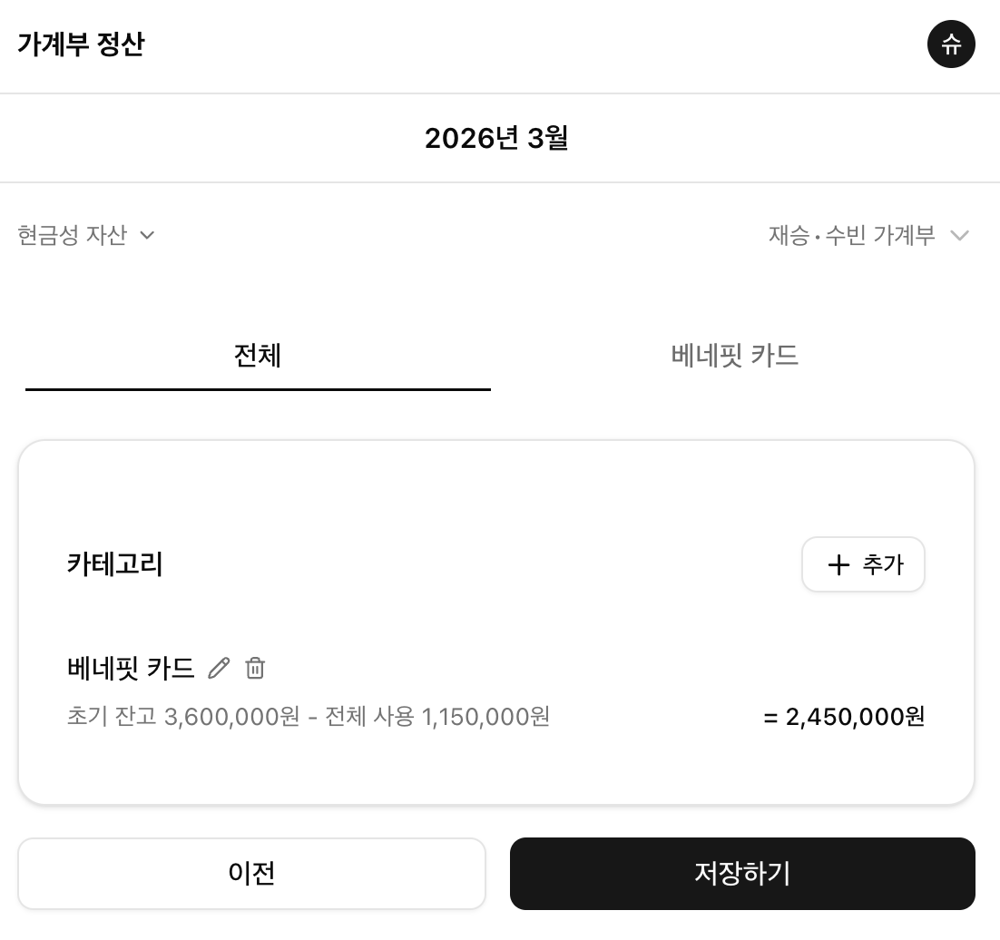
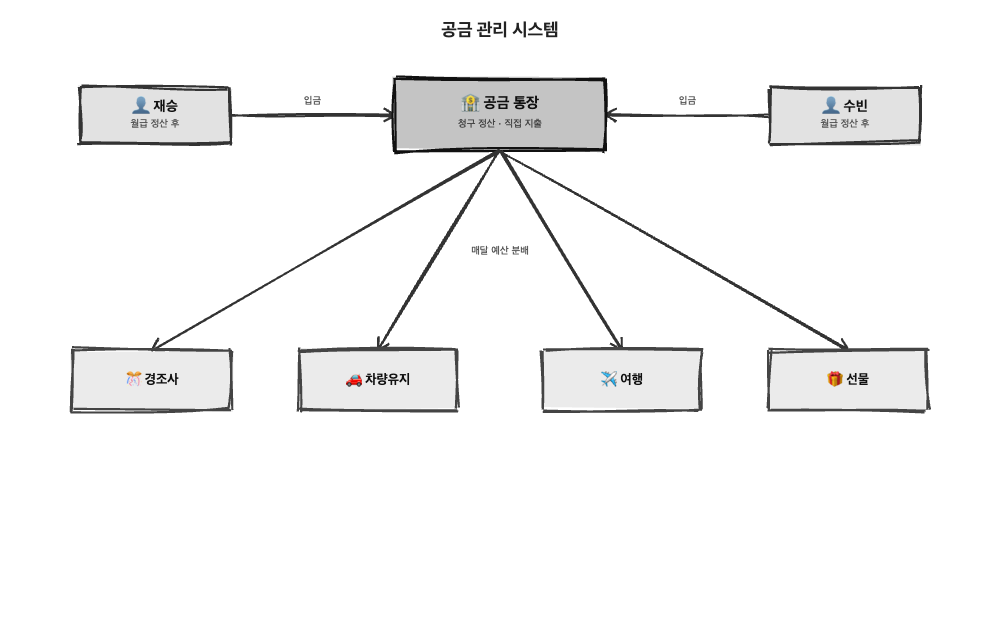

## 지난편

[지난편](https://soobing.github.io/building-with-claude-code-1)에서 유저가 한명이라도 있는 서비스를 만들어보자! 해서 시작된 우리집 가계부 서비스.
사실 너무 우리에게 최적화된 서비스라, 이걸 또 쓰고 싶어 하는 사람이 있을까 싶었지만.. 혹시 몰라 멀티 테넌트 구조로 설계해두었고, 계정 로그인과 DB도 유저별로 분리되는 형태로 개발해두었다.

<a class="link-card" href="https://soobing.github.io/building-with-claude-code-1" target="_blank" rel="noopener noreferrer">
  <svg class="link-card__icon" xmlns="http://www.w3.org/2000/svg" viewBox="0 0 24 24" fill="none" stroke="currentColor" stroke-width="2" stroke-linecap="round" stroke-linejoin="round"><path d="M10 13a5 5 0 0 0 7.54.54l3-3a5 5 0 0 0-7.07-7.07l-1.72 1.71"/><path d="M14 11a5 5 0 0 0-7.54-.54l-3 3a5 5 0 0 0 7.07 7.07l1.71-1.71"/></svg>
  
    Claude Code로 서비스를 만들며 배운 것 1 — 만드는 것과 팔리는 것은 다르다
    soobing.github.io/building-with-claude-code-1
  
</a>

## 월급이 들어오면 어떻게 처리하는가?

기존에 우리집 가계부가 어떤 형식으로 작성되었는지에 대한 설명이 먼저 필요할 것 같다.

위 다이어그램처럼, 매월 고정 수입에서 이미 정해져 있는 고정 지출, 금융 저축, 금융 지출, 의료비·교통비 등 그달 발생한 변동 지출까지 모두 제외한 나머지 금액을 전부 공금통장에 입금시킨다.
둘이 합친 공금통장 입금액은 다시 공금을 굴리기 위한 통장들로 나눠서 관리하는데, 기본적으로 공금 통장의 목적에 맞게 예산이 정해져 있다. 그리고 매달 공금 통장에서 목적이 있는 통장들(경조사, 차량유지, 여행, 선물 등등)로 정해진 예산만큼 자동이체를 시킨다.

## 엑셀에서 시스템으로

우리는 가계부를 5년째 열심히 쓰고 있고, 연말에는 꼭 연말정산하는 시간을 갖는다.
올해 얼마나 벌었고, 얼마나 썼고, 어디에 돈이 많이 들어갔는지, 투자 수익은 어떻게 되는지… 등등.

그런데 벌써 5년치 데이터가 쌓이다 보니, 매해 연말에 남편이 집계할 때마다 머리가 아파했고(돈이 안 맞거나 비거나..), 생각보다 많은 시간을 써야 했다.
그래서 시스템을 잘 만들어서 데이터를 차곡차곡 쌓고, 집계도 실시간으로 볼 수 있게 하고 싶었는데…! 너무 필요한 서비스를 내가 직접 만들어버린 거지.

## **그래서 딸깍으로 서비스를 만들었는가? Nope!**

아무래도 정산 프로세스가 꽤 복잡하다 보니, 딸깍 만들어지지는 않았다. 그럴싸하게는 만들어주지만, 생각보다 빵꾸가 꽤 많았고, 그래도 1차적으로 사용 가능하게 만드는 데 15일 정도 소요되었던 것 같다. (하루 평균 2시간 정도 투자한다고 가정)
지금 내가 가져온 건 월급 정산 부분만인데, 우리집 예산을 운영하려면 월급 정산뿐만 아니라 공금 통장 관리, 용돈 관리, 현금성 자산 관리, 투자 부분까지 꽤 빡센 세부 로직이 들어가서 개발이 필요했다.

우리는 더치페이도 자주 하는데, 더치페이에 대한 정산과 현금성 자산 관리도 구현했고,

  
  

특히 복잡한 공금 관리 시스템을 구현하는 건 버그도 많이 나오고, 쉽지 않았다.
설명을 조금 덧붙이면.. 일단 공금 통장이 존재하고, 공금통장 하위에 경조사, 차량유지, 여행, 선물 통장이 있다. 매달 정해진 예산만큼 돈이 부어지고, 각자 사용한 금액은 공금통장으로 청구를 하기도 하고, 공금통장에서 직접 지출이 일어나기도 한다. 그리고 부족한 경우에는 처음 입금했던 공금 통장에서 다시 수혈하기도 한다.

## **원하는 것을 만들기는 했으나.. 견고한가? 신뢰할 만한가??**

지금도 간혹 버그를 발견한다. 이제는 모든 버그를 다 잡았다고 생각이 들기도 하지만, 아무래도 코드를 자세히 들여다보지 않고 바이브 코딩으로만 만들었기에 머릿속에 그려지는 것이 하나도 없고, 여전히 안갯속에 있는 느낌이다. **그래서 이 시스템이 정말 신뢰할 만한지 잘 모르겠다.**

그래서 아직도 내가 만든 정산 시스템을 사용하면서, 이전에 기록하던 엑셀 시트 기입을 병행하고 있다. 나중에는 개발한 시스템과 엑셀 시트 작성도 연동할 계획이긴 하지만, 아직은 구현한 시스템에 대한 확신이 부족하다.

확신을 가지려면 어떻게 해야 할까? 많은 테스트 케이스를 작성하고, 그 테스트를 모두 통과하도록 만들면 괜찮을까? 이부분은 AI의 도움을 어디까지 받아야하고 내가 검토를 해서 비는 부분을 찾아 넣어야 하지 않을까? 등등 고민이 많이 생긴다.

웃기지만.. 견고하지 않은 느낌을 받았을떄, 한편으로는 기분이 좋기까지 했다. AI로 딸깍해서 쉽고 빠르게 많은 것을 만들 수 있게 되었지만, 그만큼 '디렉션이 명확'해야 한다는 것을 체감했기 때문일까?
이 부분에 있어서는 이쪽 지식을 가지고 있느냐 없느냐의 차이가 정말 클 것 같다는 생각이 들었다. 😊
