> 26년 3~4월 동안 진행한 프로젝트 :)

## AI FOMO로 가득하던 시기에, 이 **프로젝트**를 만나다

육아휴직 중에도 AI FOMO로 링크드인에서 AI 관련 소식을 놓치지 않겠다는 마인드로 계속 챙겨봤고 Claude Code로 이것저것 써보던 참이었다.

달레스터디에는 원래 leetcode를 함께 푸는 알고리즘 스터디로 처음 조인했다. 육아휴직 중에 AI로 뭔가 만들어보고는 싶은데 딱히 할 게 없고, 만들어도 '사람들이 진짜 필요로 하는 걸 만들고 있나?' 하는 회의감이 들던 때였다. 그렇게 AI FOMO로 가득하던 시점에, 마침 [**AI 프로젝트(AI 스터디 3기) 팀원 모집**](https://github.com/orgs/DaleStudy/discussions/19) 글이 올라왔다.

사실 이미 모집 공고 시기는 지난 상태이긴 하지만 아쉬운 마음에 댓글을 남겨봤다.

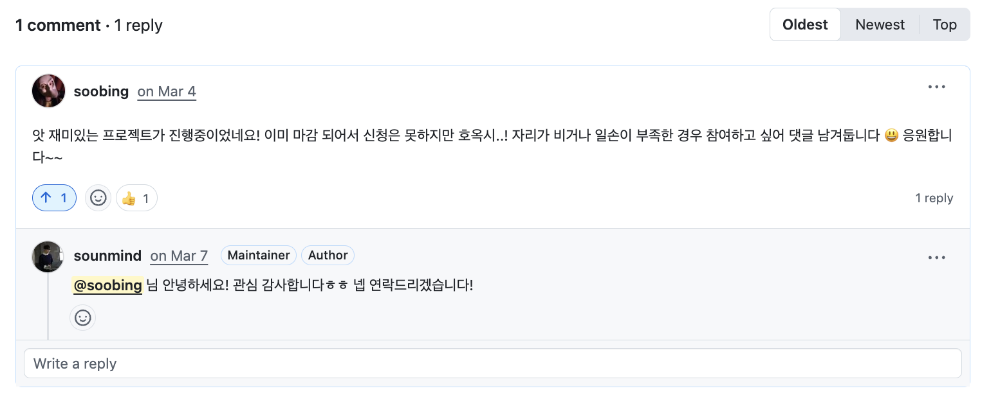

*▲ 모집이 이미 마감된 뒤였지만 아쉬운 마음에 댓글을 남겨봄. 🤣*

오픈소스에서는 AI를 어떻게 활용할까? 하는 호기심도 가득했고, 회사에서 사용하는 깃헙 엔터프라이즈에서는 AI가 코드 리뷰도 다 해주고, 업무 프로세스에 있어서 AI를 활용한 자동화가 많이 되어 있는데.. 정작 나는 서비스 개발을 하는 부서라서 이런 걸 경험해 볼 기회가 없었기 때문에 참여 의지가 뿜뿜했다.

혹시나 하는 마음에 연락을 드려놨는데.. 프로젝트 리더인 Evan이 기회를 주셨다. 마침 한 분이 첫 스터디만 참여하고 사정상 그만둔 참이었다고 한다. 😊 역시 한번 여쭤보길 잘했다.

아무튼 3-4월 동안 프로젝트를 진행하는데, 매주 정기 스크럼 미팅이 있고 프로젝트를 진행하는 사람들끼리 필요에 의해서 평일 저녁에도 계속해서 프로젝트를 진행해야 했기에.. 주말 일정을 바쁘게 잡지 않고, 오랜만에 다른 개발자들과 함께 개발에 대해서 2개월가량 집중하는 시간을 가질 수 있었던 것 같다.

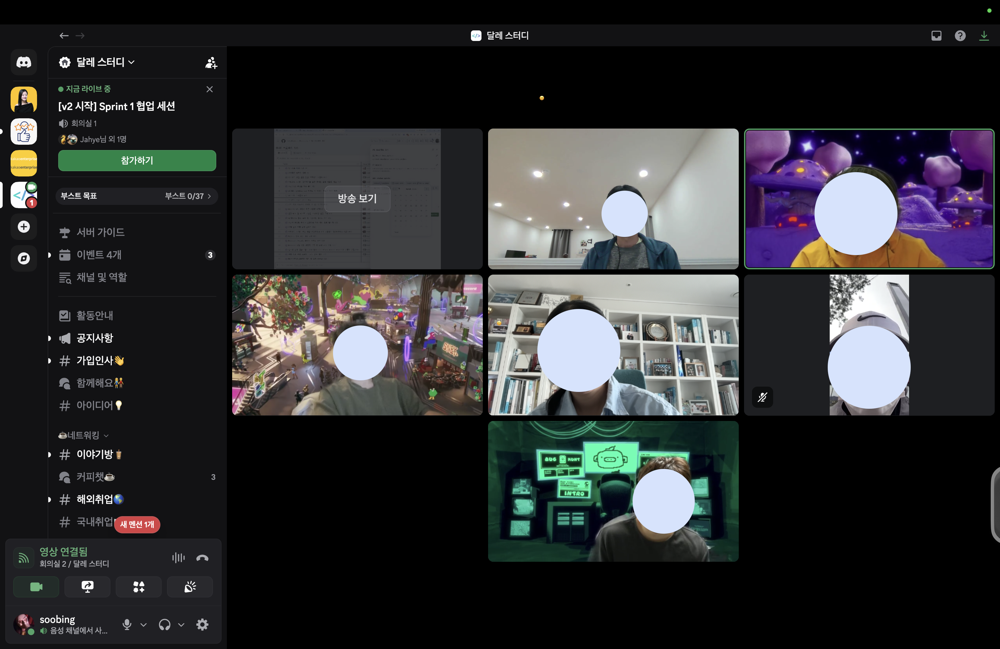

*▲ Discord 음성 채널에서 진행한 스프린트. 정기 스크럼 외에도 평일 저녁에 이렇게 모여 함께 작업했다.*

## 무엇을 만들지 '문제 정의'부터 해보자!

달레스터디는 [leetcode study](https://github.com/DaleStudy/leetcode-study) 말고도 여러 프로젝트가 함께 굴러가고 있다. 그래서 이 중 어디에 어떻게 기여하면 좋을지 고민했는데, 가장 메인이 되는 리트코드 스터디를 개선해보자는 쪽으로 의견이 모였다.

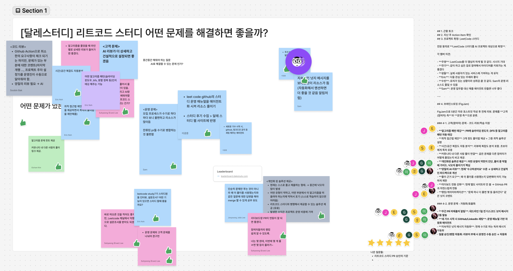

*▲ FigJam 보드 — 코드 리뷰, 복잡도 자동 분석, 개인화 솔루션, 운영 자동화 등 아이디어를 마구 붙였다.*

먼저 FigJam에 리트코드 스터디를 하면서 '이건 개선되면 좋겠다' 싶었던 의견들을 마구 모았고, 그중 우리가 해결하면 좋을 것들을 추려 종합했다.

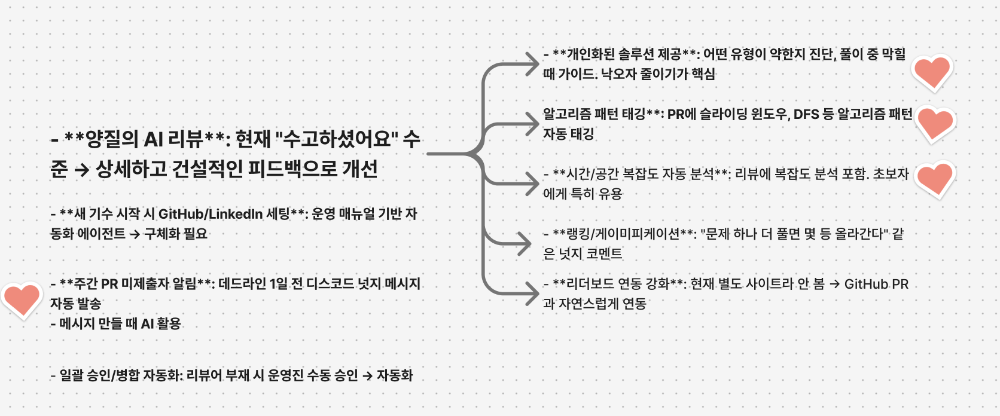

*▲ 하트로 투표해 최종 후보를 추린 모습.*

최종적으로 4가지 정도*(개인화 솔루션 제공, 알고리즘 패턴 태깅, 시간/공간 복잡도 자동 분석)*를 개선 과제로 추렸다. 팀원이 7명이라, 리더인 Evan이 두 팀에 걸치는 방식으로 2인 1조 × 4팀을 꾸려 각자 맡은 문제를 풀기로 했다.

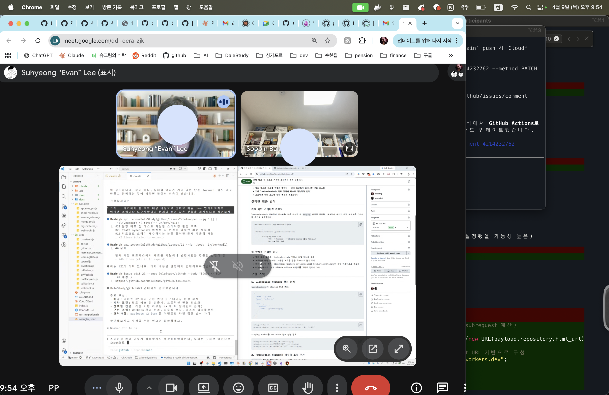

*▲ Google Meet으로 진행한 밤 시간대 페어 프로그래밍. (캐나다의 Evan과 만나려면 한국은 밤 9시~)*

나는 Evan과 한 팀이 되어, 스터디원들이 leetcode study를 끝까지 완주하도록 돕고 알고리즘 학습 목적에 맞게 공부하고 있는지 길잡이가 되어주는 [**개인화된 솔루션 제공**](https://github.com/DaleStudy/github/issues/6)(이슈 #6) 문제를 맡기로 했다.

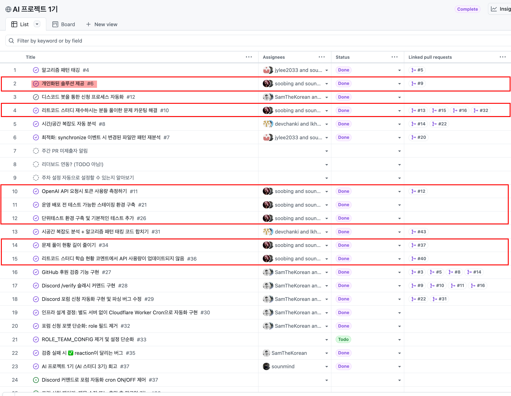

*▲ [AI 프로젝트 1기 보드](https://github.com/orgs/DaleStudy/projects/33/views/1). 빨간 표시가 내가 맡아 완료한 이슈들이다.*

## Evan & AI와 함께 '페어 프로그래밍'

프로젝트를 진행하는 방식 자체가 정말 흥미로웠는데, 리더인 Evan과 같은 팀이 된 것은 큰 행운이었다. 에반이 어떤 형태로 프로젝트를 진행하면 될지 좀 처음에 이끌어주셨는데 그 부분이 제일 흥미롭고 이번 스터디에서 큰 배움이 있었던 것 같다.

우리는 페어 프로그래밍으로 진행하되, Evan과 나 둘만이 아니라 AI(Claude Code)를 한 명 더 끼워서 개발했다. 나도 Claude Code를 쓰고는 있었지만, 지금 생각하면 일종의 고정관념 때문에 AI에게 그렇게 많은 권한을 주지 않았다. 많은 일을 맡기기보다는, 딱 내가 필요하거나 막힌 부분에만 도움을 받는 식이었다.

그런데 이번 스터디에서는 달랐다. 풀려는 문제의 아이디어를 잡고, 그 스케치를 GitHub 이슈로 만들고 description을 쓰고, 코드로 구현하고 PR을 올리는 그 모든 과정에 Claude Code를 적극 활용했다. 나는 정말 '검토만' 하는 방식으로 개발해본 게 처음이었다.

처음부터 이렇게 다 맡기지는 못했는데, '일단 한번 AI에게 맡겨보자'는 오픈 마인드의 Evan을 옆에서 보면서 나도 마음을 많이 열게 됐다 ㅋㅋ 그렇게 만든 결과물이, 지금도 돌아가고 있는 [리트코드 스터디 PR](https://github.com/DaleStudy/leetcode-study/pulls)에 아래처럼 학습 현황을 자동으로 달아주고 있다.

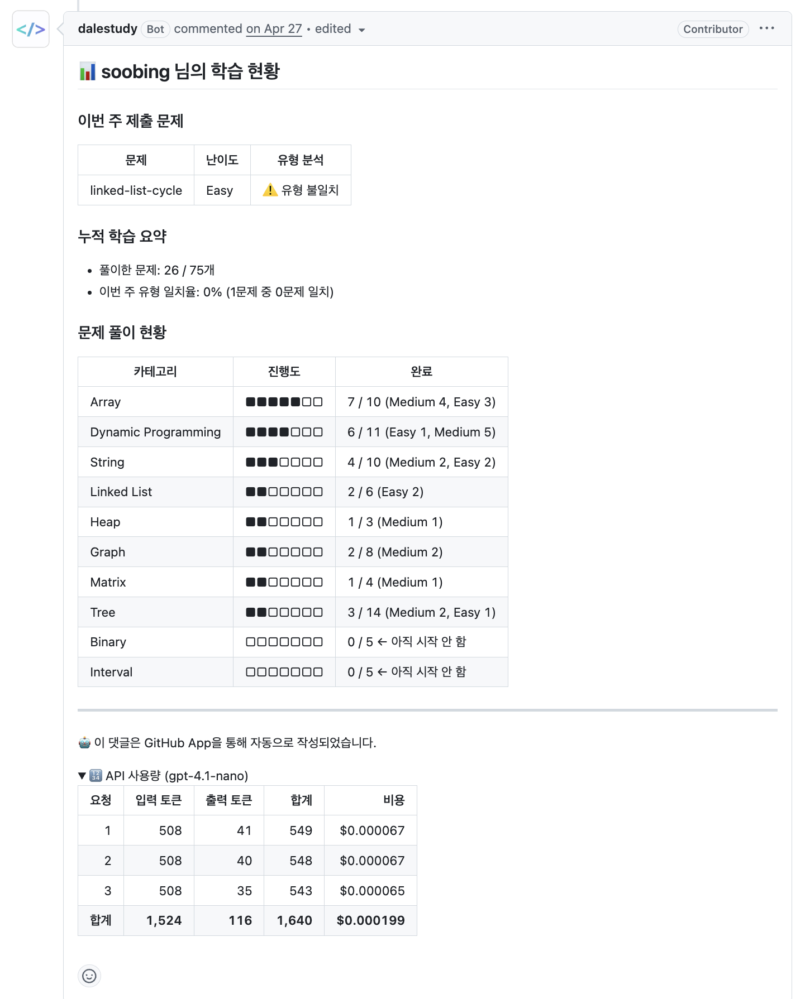

*▲ 봇이 PR마다 자동으로 남기는 "학습 현황" 댓글. 이번 주 제출 문제의 유형 일치 여부, 카테고리별 누적 진행도, 그리고 gpt-4.1-nano API 사용량·비용까지 한 번에 보여준다.*

우리가 만든 **개인화 솔루션**은 단순한 정답 풀이 설명과는 다르다. 정답 풀이는 인터넷에 널려 있지만, "유형에 맞게 문제를 풀었는지"와 "진행 상황"은 봐주지 않는다. 그래서 각 멤버에게 개개인에 맞게 리뷰 해주는 걸 목표로 삼았다. 봇이 PR마다 자동으로 하는 일은 크게 두 가지다.

- **유형(접근법) 일치 분석**: `problem-categories.json`에 문제별 *의도한 접근법*을 정의해두고, 이번 풀이가 그 의도대로 풀렸는지 판정한다. (예: two-sum을 Hash Map O(n)으로 의도했는데 브루트포스로 풀면 짚어준다.)
- **누적 학습 현황**: 별도 DB 없이 GitHub API로 그 사람의 merged PR·파일 트리를 매번 계산해, Blind 75 카테고리별 진행도를 개인 대시보드처럼 PR 댓글로 자동 업데이트한다.

---

## 두 번의 챌린지

이 문제를 풀려면 달레스터디의 [github 레포지토리](https://github.com/DaleStudy/github)(Cloudflare Worker로 도는 GitHub App)에 기여해야 했다. 이미 이 프로젝트가 `gpt-4.1-nano`를 쓰고 있었던 덕분에, AI 기능을 구현하는 것 자체는 프롬프트를 다듬는 것 외에 크게 어렵지 않았다. 진짜 챌린지는 오히려 '운영'에서 나왔다.

### 챌린지 ① Cloudflare Workers의 subrequest 한도

다른 팀도 같은 Worker 위에 AI 기능을 얹다 보니, 여러 AI 핸들러가 한 번의 Worker 실행에서 순차로 돌면서 **50 subrequest 한도를 함께 나눠 쓰는** 구조적 문제가 있었다. 학습 현황 댓글 하나만 해도 GitHub API 및 OpenAI 호출이 겹쳐, 제출 파일이 10개만 넘어가도 한도(무료 플랜 50회)에 부딪혔고 응답을 제대로 못 가져오는 일이 생겼다.

해결은 두 갈래로 접근했다. 먼저 유저의 merged PR을 PR마다 REST로 개별 조회하던 것을 **GraphQL 배치 조회**로 바꾸고, 파일별로 쪼개 부르던 OpenAI 호출도 **한 번의 배치 분석**으로 합쳐 호출 수 자체를 줄였다([PR #15](https://github.com/DaleStudy/github/pull/15)).

그다음, 애초에 여러 AI 핸들러가 한 예산을 공유하는 게 근본 원인이었으므로, 각 핸들러를 `ctx.waitUntil()` + self-fetch로 **별도 Worker 호출로 분리해 각자 독립된 50 subrequest 예산**을 갖게 했다([PR #16](https://github.com/DaleStudy/github/pull/16)).

> 💡 관련 이슈: [#10 리트코드 스터디 재수하시는 분들 풀이한 문제 카운팅 해결](https://github.com/DaleStudy/github/issues/10) · PR [#15](https://github.com/DaleStudy/github/pull/15), [#16](https://github.com/DaleStudy/github/pull/16)

덕분에 Cloudflare Workers라는 서버리스 런타임을 처음으로 다뤄보는 기회가 되었다.

### 챌린지 ② 스테이징 환경 구성과 '테스트 코드'의 중요성

규모가 큰 오픈소스가 아니다 보니 스테이징(stage) 환경이 따로 없었다. 개발 환경이 없으니 코드를 곧장 production에 배포해 테스트해야 했는데, 이게 불편할 뿐 아니라 **스터디가 진행 중이라 실제 사용자가 있는데 이렇게 개발해도 되나?** 하는 찜찜함이 컸다. 실제로 이 시기에 PR 세 개가 연속으로 리버트(#17·#18·#19)되기도 했다. 알고 보니 기능 버그가 아니라 앞서 말한 Cloudflare subrequest 한도 때문이었지만, 어쨌든 운영에 바로 영향이 갔다는 점이 스테이징 환경 이슈([#21](https://github.com/DaleStudy/github/issues/21))를 파게 된 계기였다.

스테이징 환경을 구축하려면 어떻게 해야 하는지 딥하게 들여다볼 수 있었지만, 메인테이너인 [**달레(DaleSeo)**](https://github.com/DaleSeo)의 의견은 매우 중요했는데, 오히려 관리 포인트가 너무 늘어난다는 피드백에 스테이징 환경 구축은 중단하기로 했다. 건설적으로 서로 코드 리뷰를 주고받았던 경험이 재미있었는데, 내가 한 가지 아차 싶었던 것은 테스트 코드로 이 문제를 해결할 수는 없는지에 대한 답변이었다. 테스트 코드를 안 짠 지 오래되었다 보니.. 테스트 코드를 아주 중요하게 생각하는 나였는데 그걸 애초에 고려하지 않았다는 점이 부끄러웠고 반성하는 시간이었다.

아래는 그 원인 규명과 스테이징 도입을 두고 달레와 주고받은 리뷰 스레드다. 달레는 유료 플랜(월 $5, 한도 1,000회) 전환과, subrequest 호출 수를 세는 `fetch` 래퍼로 CI에서 한도 초과를 미리 잡는 아이디어까지 코드로 제안해줬다.

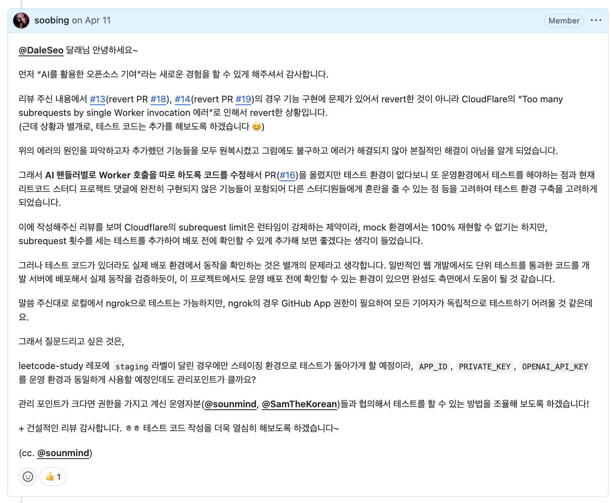

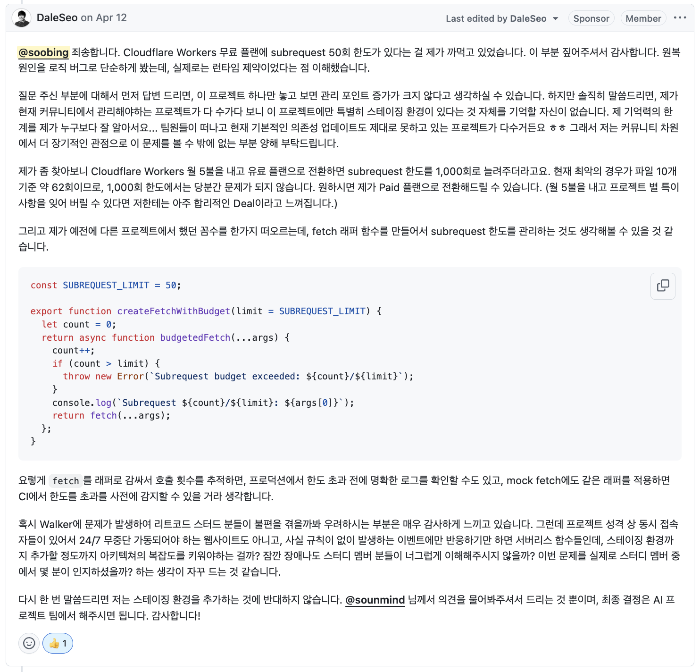

---

## 회고

프로젝트가 끝나고 마지막 주에 다 같이 회고하는 시간을 가졌는데 정말 유익했다. 2개월이라는 짧지 않은 기간을 달려왔기에 뿌듯함도, 아쉬움도 있었다.

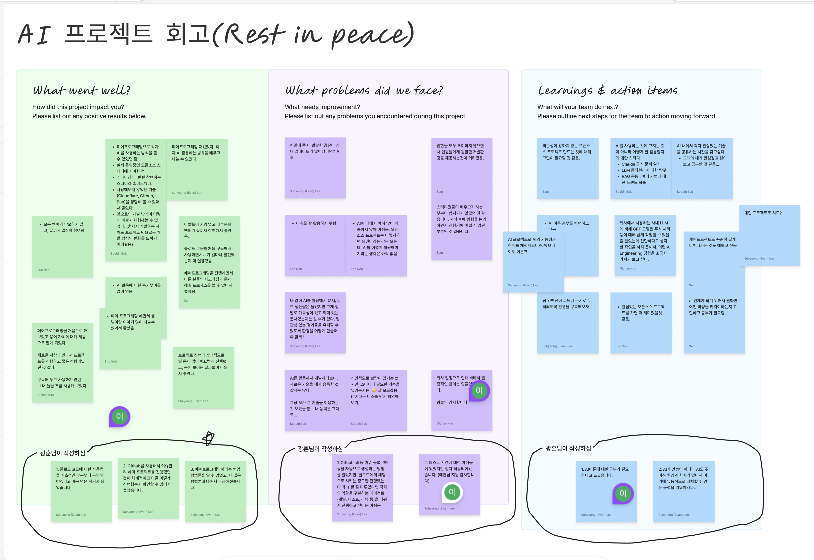

*▲ FigJam 회고 보드 — What went well? / What problems did we face? / Learnings & action items 세 축으로 정리했다.*

**좋았던 점**

- 페어 프로그래밍으로 각자 AI를 사용하는 방식을 볼 수 있었던 점.
- 실제 운영 중인 오픈소스 스터디에 기여한 점
- 캐나다/한국 반반 참여하는 스터디라 흥미로웠다.
- 사용해보지 않았던 기술 (Cloudflare, Github, Bun)을 경험해 볼 수 있어서 좋았다.
- 앞으로의 개발 방식이 어떻게 바뀔지 체험해볼 수 있었다. (혼자서 개발하는 사이드 프로젝트만으로는 개발 방식의 변화를 느끼기 어려웠음)

**아쉬웠던 점**

- AI를 활용해서 개발하다 보니, 새로운 기술을 내가 습득한 것 같지는 않다.
- 그냥 AI가 그 기술을 이용하는 것 보았을 뿐... 내 능력은 그대로...
- 개인적으로 보람이 있기는 했지만, 스터디에 필요한 기능을 넣었는지는...😊 잘 모르겠음. (2기 때는 니즈를 먼저 파악해보기)

**앞으로는?**

AI를 사용하는 것에 그치는 것이 아니라 어떻게 잘 활용할지에 대한 스터디를 진행하면 좋겠다.

- Claude 공식 문서 읽기
- LLM 동작 원리에 대한 탐구
- RAG 등등.. 여러 기법에 대한 트렌드 학습

AI 내에서 각자 관심 있는 기술을 공유하는 시간을 갖고 싶다. (그래야 내가 관심 갖고 찾아보고 공부할 것 같음…)

요 정도로 회고를 했던 것 같다.

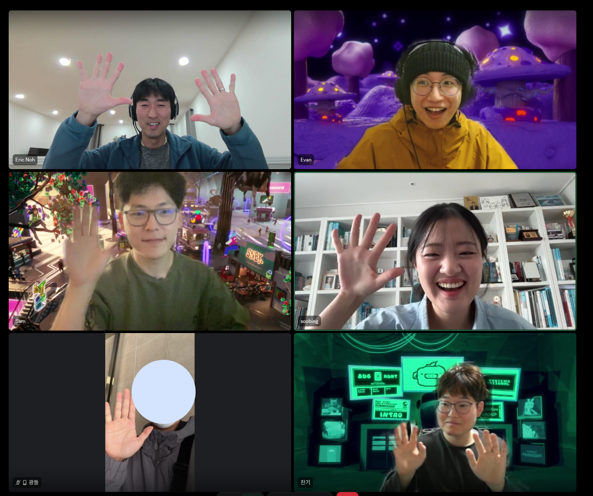

*▲ 마지막 미팅. 다들 표정이 너무 귀여워서 이 사진만큼은 얼굴을 가리고 싶지 않아서 동의를 구했다 :)*

---

## 달레줄레 팟캐스트 출연

프로젝트가 끝나고 5월 가정의 달을 쉬어간 뒤, 6월에 새로운 주제로 다시 스터디에서 만나기로 하고 있었다. 그러던 중, 우리 프로젝트에 줄레(번개발)님이 함께해주셔서였을까 **달레줄레 팟캐스트**에 출연할 기회가 생겼다.

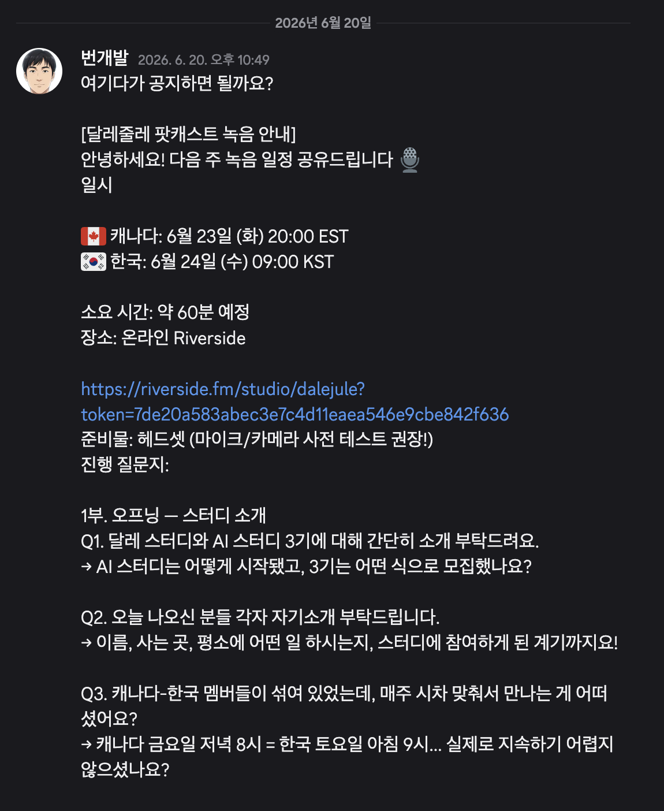

*▲ 번개발님이 Discord에 공유해준 녹음 안내.*

오~~ 인생 첫 팟캐스트 녹음이라니 ㅎㅎ 한국 개발 쪽에서는 팟캐스트가 흔치 않아서, 더 참여해보고 싶었고 특별하게 다가왔다.

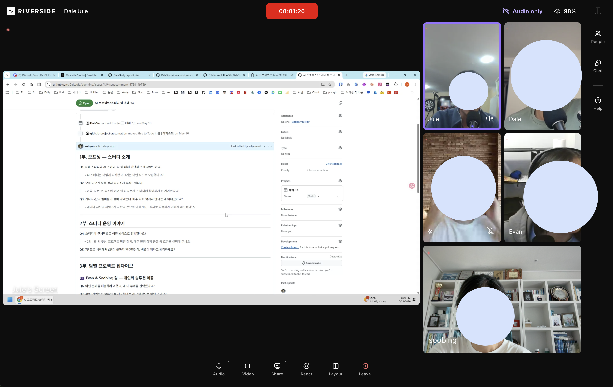

*▲ Riverside 녹음 현장. Jule, Dale, Sam, Evan, 그리고 나(soobing)까지 화면 공유로 질문지를 함께 보며 이야기를 나눴다.*

그렇게 녹음을 마쳤다.

[EP.22 AI 스터디 초대석: 개발자들은 AI를 어떻게 공부할까?](https://dalejule.com/episodes/22/)

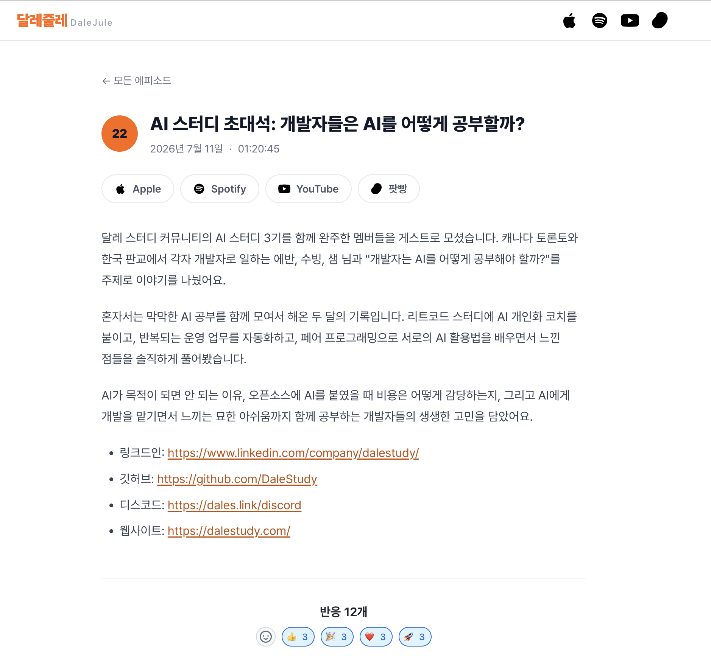

*▲ 공개된 [EP.22 "AI 스터디 초대석: 개발자들은 AI를 어떻게 공부할까?"](https://dalejule.com/episodes/22/). Apple·Spotify·YouTube·팟빵에서 들을 수 있다.*

팟캐스트가 한국에서는 흔치 않은데, 달레·줄레 두 분 모두 캐나다에 계셔서인지 꾸준히 개발 이야기를 업로드하고 계신 점이 무척 흥미로웠다. 어떻게 팟캐스트를 하게 되셨냐고 여쭤봤는데, 집안일이나 손을 사용할 수 없는 일을 하면서 팟캐스트를 많이 듣는데, 한국 개발자들이 진행하는 개발 팟캐스트는 많지 않아서 꾸준히 개발 관련 지식을 공부도 할 겸 하여 업로드하신다고 하셨다. 뭐든지 꾸준히, 자신이 좋아하는 것을 해나가는 모습이 보기 좋았다.

## 마무리

혼자였다면 몰랐을 AI로 인한 '개발 방식의 변화'를 이번 프로젝트를 진행하면서 몸으로 체감할 수 있었다. 다만, AI가 기술을 활용하는 걸 구경하는 데서 그치지 않고, 원리까지 파고들어 'AI를 잘 부리는' 개발자가 되는 것이 중요할 것 같다.
